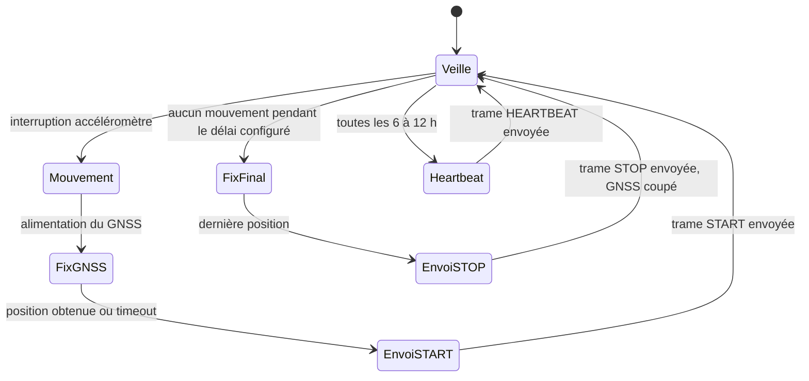
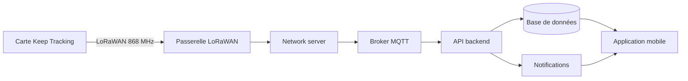
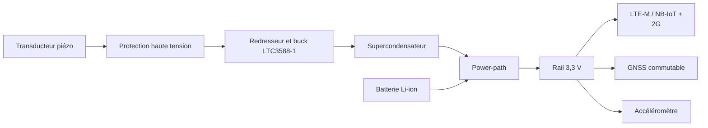

<div align="center">

# Keep Tracking

### Traceur GPS discret et autonome 


*Projet d'ingénierie, année universitaire 2026-2027, encadré par M. Duclos.*

</div>

---

## Sommaire

1. [Vue d'ensemble](#1-vue-densemble)
2. [Fonctionnalités](#2-fonctionnalités)
3. [Fonctionnement](#3-fonctionnement)
4. [Architecture du système](#4-architecture-du-système)
5. [Matériel](#5-matériel)
6. [Logiciel](#6-logiciel)
7. [Sûreté de fonctionnement](#7-sûreté-de-fonctionnement)
8. [Analyse du marché](#8-analyse-du-marché)
9. [Modèle d'entreprise](#9-modèle-dentreprise)
10. [Feuille de route](#10-feuille-de-route)
11. [Risques et points ouverts](#11-risques-et-points-ouverts)
12. [Organisation de l'équipe](#12-organisation-de-léquipe)
13. [Structure du dépôt](#13-structure-du-dépôt)
14. [Conventions de contribution](#14-conventions-de-contribution)
15. [Références](#15-références)

---

## 1. Vue d'ensemble

**Keep Tracking** est un traceur GPS antivol conçu pour les deux-roues. Il répond à la hausse des vols de motos et de scooters, et au constat que la majorité des deux-roues volés ne sont jamais retrouvés *(chiffre à sourcer avant diffusion)*.

Les solutions actuelles imposent un compromis : abonnement obligatoire, batterie à recharger ou à remplacer, ou branchement sur la batterie de la moto. Keep Tracking vise une proposition différente.

| Objectif | Description |
|---|---|
| **Discrétion** | Boîtier petit et indétectable par un voleur |
| **Autonomie énergétique** | Batterie interne prolongée par récupération d'énergie piézoélectrique |
| **Installation simple** | Aucun câblage sur le circuit électrique de la moto |
| **Prix accessible** | Environ 300 DH (environ 28 €), sans abonnement |

**Marché initial :** Salé, Kénitra et Rabat (Maroc).

> **Statut du projet :** phase de conception. Les composants et architectures ci-dessous sont des propositions d'ingénierie, à valider par des mesures et des prototypes.

---

## 2. Fonctionnalités

- Détection d'un mouvement anormal par accéléromètre
- Localisation GNSS multi-constellation (GPS, Galileo, GLONASS, BeiDou)
- Transmission d'alertes sans abonnement cellulaire (LoRaWAN)
- Signe de vie périodique (*heartbeat*) pour détecter un boîtier silencieux
- Récupération d'énergie par vibrations pour prolonger l'autonomie
- Application mobile : carte, historique, état de la batterie, mode garé
- Charge USB-C de la batterie interne

---

## 3. Fonctionnement

La carte reste en veille profonde la quasi-totalité du temps. Seul l'accéléromètre reste actif et réveille le microcontrôleur au début d'un mouvement.



### Trames émises

| Trame | Déclencheur | Contenu |
|---|---|---|
| `START` | Début de mouvement | Position, niveau de batterie, qualité GNSS |
| `STOP` | Absence de mouvement pendant un délai configurable | Dernière position, niveau de batterie |
| `HEARTBEAT` | Périodique (1, 6, 12 ou 24 h, à choisir) | Niveau de batterie, état de la carte |

### Format de trame proposé (environ 12 octets)

| Champ | Taille | Rôle |
|---|---|---|
| Type d'événement | 1 octet | START, STOP ou HEARTBEAT |
| Latitude | 4 octets | Position |
| Longitude | 4 octets | Position |
| Batterie | 1 octet | État de charge |
| Qualité GNSS | 1 octet | Fiabilité du fix |
| Drapeaux | 1 octet | Alertes, état interne |

---

## 4. Architecture du système



Le système se décompose en trois blocs : **matériel**, **serveur** et **interface**, complétés par une analyse fonctionnelle et un dossier de sûreté.

---

## 5. Matériel

### 5.1 Synoptique de la carte

| Fonction | Composant proposé | Rôle |
|---|---|---|
| Microcontrôleur et radio LoRa | STMicroelectronics STM32WLE5CCU6 | Cortex-M4 avec radio sub-GHz intégrée |
| GNSS | u-blox MAX-M10S | Réception multi-constellation basse consommation |
| Accéléromètre | STMicroelectronics LIS2DW12 | Détection de mouvement et réveil par interruption |
| Récupérateur piézo | Analog Devices LTC3588-1 | Redresseur et convertisseur buck pour source piézo |
| Chargeur et power-path | Texas Instruments BQ24074 | Charge Li-ion 1S depuis USB |
| Régulateur 3,3 V | Texas Instruments TPS63900 | Buck-boost très basse consommation |
| Interrupteur GNSS | Texas Instruments TPS22916 | Coupure complète du GNSS en veille |
| Jauge de batterie | Analog Devices MAX17048 | Estimation de l'état de charge |
| Protection batterie | ABLIC S-8261 et Alpha and Omega AO8814 | Surtension, sous-tension, surcourant |
| Réservoir d'énergie | Supercondensateur (10 F / 2,7 V indicatif) | Tampon pour l'énergie piézo |
| Batterie | Li-ion ou LiPo 1S, 2000 mAh de départ | Source principale |
| Connectique | USB-C, JST (batterie, piézo), Tag-Connect (SWD) | Charge, intégration, programmation |

> Les références et empreintes sont des choix d'ingénierie proposés. Elles doivent être confirmées par les datasheets et la disponibilité avant le schéma de production.

### 5.2 Principe énergétique

Le transducteur piézoélectrique ne se connecte **jamais directement** à la batterie Li-ion : sa tension est alternative, irrégulière et peut atteindre plusieurs dizaines de volts à vide.



L'énergie récupérée est stockée dans un supercondensateur puis injectée sur le rail du système. Elle soulage la batterie pendant les vibrations et prolonge l'autonomie. Une recharge directe significative de la batterie par un petit piézo de véhicule est peu probable sans caractérisation mécanique de la source : **le gain réel doit être mesuré sur prototype**.

### 5.3 Contraintes PCB et RF

- PCB 4 couches avec plan de masse continu
- Antenne LoRa en bord de carte avec zone d'exclusion de cuivre conforme à la datasheet
- Antenne GNSS séparée physiquement de l'antenne LoRa, sans convertisseur à découpage en dessous
- Lignes RF en impédance contrôlée 50 Ω
- LTC3588 et boucle piézo éloignés du GNSS pour limiter le bruit impulsionnel
- Connecteurs U.FL optionnels pour les essais avec antennes externes

---

## 6. Logiciel

### 6.1 Firmware (STM32WLE5)

- Machine à états : veille, mouvement, fix GNSS, envoi, veille
- Veille profonde (STOP ou STANDBY), GNSS hors tension, radio en veille
- Réveil par interruption de l'accéléromètre uniquement
- Timeout d'acquisition GNSS
- Protocole LoRaWAN avec activation OTAA et clés uniques par carte
- Mise à jour du firmware (à étudier)

### 6.2 Serveur

| Brique | Rôle | Option envisagée |
|---|---|---|
| Passerelles LoRaWAN | Réception des trames | À déployer (Salé, Kénitra, Rabat) |
| Network server | Gestion des appareils et sécurité radio | ChirpStack ou The Things Stack |
| Broker de messages | Acheminement des trames | MQTT (Mosquitto) |
| API backend | Décodage, logique métier, API | Python (FastAPI) ou Node.js |
| Base de données | Utilisateurs, motos, positions, trajets | PostgreSQL et PostGIS |
| Notifications | Alerte au propriétaire | Push (Firebase), SMS, e-mail |

**Fonctions du backend :** authentification, association carte, moto et propriétaire, décodage des trames, historique des trajets, règles d'alerte (mouvement alors que la moto est garée, batterie faible, heartbeat manquant), administration du parc de cartes.

### 6.3 Application mobile

Application multiplateforme (Flutter ou React Native).

**Version minimale (MVP) :**
- Inscription et ajout d'une moto via le code de la carte
- Carte avec la dernière position connue
- Mode **Garé / Roulage**
- Alerte push en cas de mouvement non autorisé
- Historique des trajets
- État de la batterie de la carte

**Évolutions :** zone de sécurité (geofence), partage avec un proche, plusieurs motos, interface d'administration.

> **Point de conception critique :** la carte n'embarque pas de Bluetooth et ne peut pas distinguer le propriétaire d'un voleur. Sans mode garé ou zone de sécurité, chaque trajet normal déclencherait une alerte. Ce choix impacte à la fois le firmware, le serveur et l'application.

---

## 7. Sûreté de fonctionnement

### 7.1 Analyse fonctionnelle

- Bête à cornes : à qui le produit rend service, sur quoi il agit, dans quel but
- Fonctions principales : détecter un déplacement anormal, localiser, alerter, afficher
- Fonctions contraintes : discrétion, autonomie, résistance aux vibrations, à l'eau et à la chaleur, coût, conformité radio et données
- Diagramme pieuvre, cahier des charges fonctionnel chiffré, diagramme FAST

### 7.2 Dossier de sécurité (safety case)

| Risque | Exemple | Mesure à justifier |
|---|---|---|
| Batterie Li-ion | Surcharge, court-circuit, emballement thermique, chaleur sous la selle | Protection de la cellule, limite du courant de charge, tests thermiques |
| Haute tension piézo | Plusieurs dizaines de volts à vide | Protection TVS, isolation, boîtier fermé |
| Supercondensateur | Surtension, déséquilibre si deux cellules | Tension limitée par le LTC3588, équilibrage |
| Environnement moto | Vibrations, eau, chaleur, chocs | Indice IP, tests de vibration, fixation |
| Défaillance fonctionnelle | Pas d'alerte, fausse alerte, fix GNSS raté, pas de réseau | Heartbeat, alerte boîtier silencieux, AMDEC |
| Cybersécurité et vie privée | Détournement du traceur, fuite de positions | Clés uniques par carte, chiffrement, comptes sécurisés, loi 09-08 |
| Conformité | Radio 868 MHz, CEM, transport de la batterie | Homologation radio au Maroc (à confirmer), CE/RED si export, UN38.3 |

**Méthode :** lister les dangers, évaluer gravité et probabilité, définir les mesures, prouver par des tests. Les normes citées sont indicatives et à vérifier.

### 7.3 Fiabilité prévisionnelle (FIDES)

- Définition du profil de mission de la moto (vibrations, température, humidité, cycles)
- Calcul du taux de défaillance de chaque composant de la nomenclature
- Identification des points faibles et mesures correctives

---

## 8. Analyse du marché

### 8.1 Chiffres clés

| Indicateur | Valeur |
|---|---|
| Marché mondial des traceurs GPS (2025) | Environ 4 Md$ (estimations de 3,6 à 4,6 Md$) |
| Croissance annuelle estimée | 12 % à 17 % |
| Part de la gestion de flottes | Environ 53 % |
| GPS personnels (2025) | Environ 1,19 Md$ |

*Chiffres mondiaux issus d'études sectorielles. Aucune donnée spécifique au Maroc n'a encore été collectée.*

### 8.2 Concurrence et positionnement

| Offre | Prix d'achat | Abonnement | Coût sur 3 ans |
|---|---|---|---|
| Monimoto 9 | 169 € | 39 € par an | environ 286 € |
| Invoxia Tracker Pro Max | 179 € | 59,85 € par an | environ 359 € |
| PAJ Vehicle Finder 4G | environ 40 € | environ 5 € par mois | environ 220 € |
| **Keep Tracking (cible)** | **environ 28 € (300 DH)** | **aucun** | **environ 28 €** |

Keep Tracking vise la zone « prix bas, sans abonnement ». Les prix des concurrents sont des repères tirés de sites français, non convertis en dirhams.

---

## 9. Modèle d'entreprise

- Forme juridique : SARL soumise à l'impôt sur les sociétés
- Siège : Kénitra
- Distribution initiale : Salé, Kénitra, Rabat
- Prix visé : 300 DH par traceur, sans abonnement
- Clients : motards (cible principale) et fabricants de motos installés au Maroc (intégration en série)

> Le coût de production, de distribution et d'infrastructure serveur reste à chiffrer pour valider la viabilité du prix de 300 DH.

---

## 10. Feuille de route

- [ ] **Phase 1 : cadrage.** Choix de la technologie de transmission, cahier des charges chiffré, analyse fonctionnelle
- [ ] **Phase 2 : caractérisation.** Mesure du piézo sur une moto, budget énergétique, estimation du coût de la carte
- [ ] **Phase 3 : conception.** Schéma, routage du PCB, boîtier, premier prototype
- [ ] **Phase 4 : développement.** Firmware, serveur et application (MVP) en parallèle
- [ ] **Phase 5 : validation.** Analyse de risques, fiabilité FIDES, tests de vibration, d'étanchéité et de température
- [ ] **Phase 6 : intégration.** Essais sur moto, mesure de l'autonomie réelle, dossier final et soutenance

---

## 11. Risques et points ouverts

| N° | Point | Enjeu |
|---|---|---|
| 1 | **Technologie de transmission** : l'étude de marché évoque LTE-M/2G, la conception matérielle retient LoRaWAN | LoRaWAN : couverture des passerelles au Maroc et réglementation de la bande 863-870 MHz. Cellulaire : SIM et coût récurrent, contradictoire avec « sans abonnement » |
| 2 | **Gain de la récupération piézo** | À prouver par mesure avant de l'utiliser comme argument commercial |
| 3 | **Prix de 300 DH** | À confronter au coût de production à 100 et 1000 unités |
| 4 | **Mode garé** | Décision d'architecture touchant firmware, serveur et application |
| 5 | **Événements ou temps réel** | Le design actuel n'offre pas le suivi continu de certains concurrents |
| 6 | **Données de marché marocain** | Nombre de motos, statistiques de vol, concurrents locaux, prix acceptable |
| 7 | **Définition d'« invisible »** | Taille, boîtier, emplacement sur la moto |

---

## 12. Organisation de l'équipe

| Membre | Responsabilité | Livrables principaux |
|---|---|---|
| **Alae** | Analyse fonctionnelle et intégration | Bête à cornes, pieuvre, cahier des charges, FAST, dossier final |
| **Bachir** | Matériel et firmware | Mesure du piézo, schéma et PCB, budget énergétique, prototype, firmware |
| **Yassine** | Serveur et interface | Réception des trames, base de données, API, alertes, application mobile |
| **Nidal** | Dossier de sécurité (QHSE) | Analyse des dangers, AMDEC, conformité, plan de tests |
| **Wissal** | Fiabilité FIDES | Profil de mission, taux de défaillance par composant, synthèse |

**Encadrement :** M. Duclos

---

## 13. Structure du dépôt

*Structure cible, à créer au fil de l'avancement.*

```text
Keep_Tracking/
├── README.md
├── docs/
│   ├── analyse-fonctionnelle/
│   ├── etude-de-marche/
│   └── rapports/
├── hardware/
│   ├── schematics/
│   ├── pcb/
│   ├── bom/
│   └── mesures-piezo/
├── firmware/
├── server/
├── app/
└── safety/
    ├── safety-case/
    ├── amdec/
    └── fides/
```

---

## 14. Conventions de contribution

- **Branches :** `main` reste stable. Chaque tâche se fait sur une branche dédiée, par exemple `hardware/pcb-v1`, `firmware/etat-veille`, `server/api-trames`
- **Commits :** messages courts et explicites, à l'impératif, par exemple `Ajoute la machine à états du firmware`
- **Pull requests :** relecture par au moins un autre membre avant fusion dans `main`
- **Tickets (Issues) :** une tâche par ticket, assignée à un responsable, étiquetée par bloc (`hardware`, `firmware`, `server`, `app`, `safety`, `fides`, `analyse`)
- **Documents :** privilégier des formats versionnables (Markdown, schémas exportés) et nommer les fichiers de façon cohérente

---

## 15. Références

- Rapport « Business plan et étude de marché » : description de l'idée, marché, concurrents
- Rapport « Architecture matérielle détaillée » : composants, chaîne piézoélectrique, câblage, nomenclature
- Données de marché : Global Market Insights, Market Research Future, Grand View Research, Mordor Intelligence
- Concurrents : Monimoto, Invoxia, GeoRide, PAJ GPS, Apple AirTag, Samsung SmartTag

---

<div align="center">

**Keep Tracking** · INSA Centre Val de Loire · 2026-2027

*Document vivant : ce README évolue avec le projet.*

</div>
